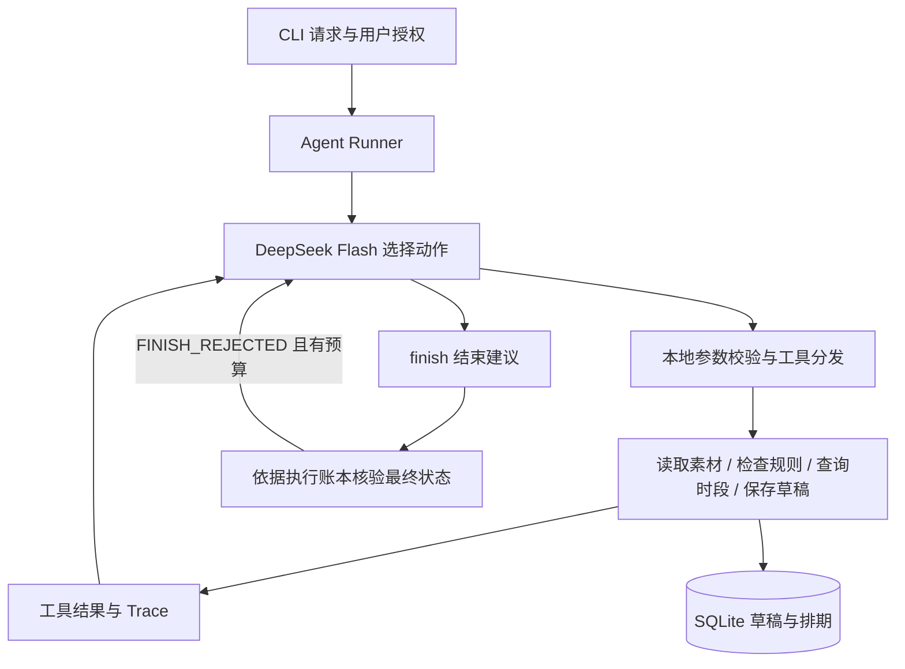

# 素材审核与发布排期 Agent

小影科技 AI Agent 笔试第 1 题。帮助内容运营读取待处理素材、审核元数据、查找无冲突时段，并保存可确认的排期草稿。

GitHub 仓库：[Fahaxiki1001/material-scheduler-agent](https://github.com/Fahaxiki1001/material-scheduler-agent)。

采用 **Python CLI + 自定义轻量 Agent Runner + DeepSeek Flash + SQLite**。模型根据工具结果选择下一步，代码强制校验审核、时间授权、占用和保存结果。仅操作合成数据与本地草稿，不接入真实发布。

## 验证结果与评审入口

验证日期：2026-10-28；环境：Python 3.12.10；真实模型：`deepseek-flash`。

| 验证 | 实际结果 | 原始证据 |
| --- | --- | --- |
| 最新真实模式验收 | **14/14 通过** | [升级后报告](examples/real/deepseek-upgraded-03/report.json) |
| 首轮真实模式验收 | 10/12，保留失败与改进记录 | [首轮报告](examples/real/deepseek-run-01/report.json) |
| 离线流程验收 | 14/14 通过 | [Mock 报告](examples/mock/upgraded-03/report.json) |
| 受控真实自纠探针 | 通过，首轮诱导提前结束后按反馈补齐工作 | [探针报告](examples/real/finish-recovery-probe-03/report.json) |
| 自动测试 | **87/87 通过** | [测试原始输出](examples/test-results.txt) |

建议先看 [验收与改进说明](docs/03-evaluation.md)，再对照下方 Trace 检查工具调用。14 个场景中的请求缺失场景由输入校验直接结束，没有调用模型；其余真实模式记录来自实际 API 请求。一次完整通过不代表所有输入或未来模型版本都可靠。

## 快速运行

要求 **Python 3.11+**。运行时与自动测试只使用标准库，无须安装第三方依赖。以下命令均在项目根目录执行。

### 无密钥运行

```bash
export PYTHONPATH="$PWD/src"

python3 -m scheduler_agent run \
  --input examples/inputs/normal.json \
  --mode mock \
  --db runs/quickstart.db

python3 -m unittest discover -s tests -v
```

正常示例保存一份 2026-10-29 19:00–19:30 的合成排期草稿。再次执行同一请求，返回 `already_exists` 和相同 `draft_id`。每次运行在 `runs/<时间>-<随机编号>/` 留下 `input.json`、`output.json` 和 `trace.jsonl`。

Mock 是显式确定性替身，只验证流程、工具与工程边界，不能作为真实模型决策证据。真实模式失败时不会自动切换为 Mock。

### 使用 DeepSeek Flash

首次配置时复制 `.env.example` 为 `.env`；已有 `.env` 时保留现有文件，填写或检查以下变量：

```dotenv
AGENT_API_KEY=填写你的DeepSeek密钥
AGENT_MODEL=deepseek-flash
AGENT_BASE_URL=https://api.deepseek.com
AGENT_TIMEOUT_SECONDS=45
```

```bash
export PYTHONPATH="$PWD/src"

python3 -m scheduler_agent run \
  --input examples/inputs/conflict.json \
  --mode real \
  --db runs/real-demo.db
```

客户端调用 `/chat/completions`，显式关闭思考模式，设置 `temperature=0`，每次最多输出 2048 tokens。标准端点不发送 Beta `strict` 标记；参数校验和每回合单工具限制由本地代码执行。配置细节、CA 处理与官方来源见 [DeepSeek 接入说明](docs/06-deepseek-setup.md)。

`.env` 和运行数据库已被 Git 忽略。密钥不进入模型对话或 Trace；也支持 `DEEPSEEK_API_KEY`，不会把 `OPENAI_API_KEY` 自动发送到 DeepSeek。系统环境变量优先于 `.env`，配置文件不执行 shell 或变量展开。

可选安装方式：`python3 -m pip install -e .`，安装后使用 `scheduler-agent` 命令。该方式需要 setuptools 构建依赖，当前未验证联网构建；直接源码运行已验证。

## Agent 如何作决策



Runner 负责通用调用循环、错误处理、调用上限和日志，不按风险或冲突预排业务分支。模型决定是否补查、选择哪个替代时段、保存、请求确认或停止。

| 动作 | 职责 |
| --- | --- |
| `read_material` | 读取元数据、缺失项及当前请求已有草稿 |
| `check_rules` | 返回审核状态、风险原因、规则 ID 和确认要求 |
| `query_slots` | 查询候选占用，返回可用性、授权状态和可补查起点 |
| `save_draft` | 在事务内复核规则、用户授权、时段冲突与幂等，提交后返回回执 |
| `finish` | 模型提出结束状态与明确选定的建议时段，由执行账本核验 |

实际真实路径：

| 场景 | 模型观察后的动作 | 结果与证据 |
| --- | --- | --- |
| 正常 | 查询 19:00 可用后保存 | completed / saved，[Trace](examples/real/deepseek-upgraded-03/normal/trace-1.jsonl) |
| 硬性时段冲突 | 发现 18:00 占用，补查并选择 18:30 | needs_confirmation，未保存，[Trace](examples/real/deepseek-upgraded-03/hard_conflict/trace-1.jsonl) |
| 授权窗口内冲突 | 发现 19:00 占用，补查后选择 19:30 | 窗口内已获授权，保存完成，[Trace](examples/real/deepseek-upgraded-03/changed_occupancy/trace-1.jsonl) |
| 读取暂时失败 | 观察 READ_FAILED 后选择重试 | 最终完成，[Trace](examples/real/deepseek-upgraded-03/read_failure_recovery/trace-1.jsonl) |

硬性时间的替代建议必须通过 `finish.suggested_start` 明确选定，并有查询证据；代码不会默认替模型挑选第一个空闲时段。

## 确认、冲突与保存边界

- **硬性要求**：变更时段必须有用户输入中的 `approved_alternative` 精确确认，模型不能自行传入 `confirmed=true` 授权。
- **灵活要求**：`time_constraint=flexible` 必须同时给出 `allowed_window`，窗口内变更已获授权，无须再次确认；人工复核要求仍单独生效。
- **冲突检查**：保存时使用 SQLite `BEGIN IMMEDIATE`，在同一写事务中重新检查占用并插入，避免查询后被其他请求抢占。
- **防重复**：`(request_id, material_id)` 唯一约束；同内容返回原草稿，同键不同请求或草稿内容返回 `IDEMPOTENCY_CONFLICT`。
- **结果真实**：只有提交成功才能报告已保存。幂等重放的 `validation_scope=original_save` 只反映原保存审核，不代表按最新规则重新审核。
- **保存错误独立**：`save_error` 保留实际保存故障，不会被后续其他工具错误覆盖；真正保存成功后才清除。
- **结束自纠**：错误的 `finish` 返回 `FINISH_REJECTED`，由模型根据执行证据继续决策；默认第 2 次拒绝时返回 `incomplete`，可用 `--max-finish-rejections` 配置。
- **有界执行**：默认最多 8 次模型决策、12 次调用（含 `finish`），达到上限返回 `incomplete`。此前若已保存，仍保留实际草稿回执。

### 演示确认与重复提交

使用独立数据库，避免其他演示的草稿占位：

```bash
# 18:00 已占用：补查替代时段，等待确认，不保存。
python3 -m scheduler_agent run --input examples/inputs/conflict.json --mode mock --db runs/confirmation-demo.db

# 用户输入明确确认 19:00–19:30：查询并保存该时段。
python3 -m scheduler_agent run --input examples/inputs/confirmed.json --mode mock --db runs/confirmation-demo.db

# 相同确认再次提交：返回原草稿。
python3 -m scheduler_agent run --input examples/inputs/confirmed.json --mode mock --db runs/confirmation-demo.db
```

故障演示使用新的数据库，预期退出码为 1，`save_status=failed`，事务回滚：

```bash
python3 -m scheduler_agent run --input examples/inputs/normal.json --mode mock --db runs/failure-demo.db --simulate-save-failure
```

## 复现验收

```bash
export PYTHONPATH="$PWD/src"

# 无模型调用，验证工具、事务、Runner、HTTP 协议和 CLI。
python3 -m unittest discover -s tests -v

# 离线场景评估。
python3 -m scheduler_agent evaluate --mode mock --output runs/evaluation-mock-new

# 真实模型场景评估，需要配置密钥并能连接 DeepSeek。
python3 -m scheduler_agent evaluate --mode real --output runs/evaluation-real-new
```

输出目录必须为空；重复评估请换新目录，程序不会覆盖既有证据。每个场景保留输入、实际输出、JSONL Trace、数据副本与数据库快照。独立场景使用独立临时数据库；重复提交的两次运行共享数据库。

单独运行真实模型的受控自纠探针：

```bash
python3 examples/run_finish_probe.py --output runs/finish-probe-new
```

探针通过披露的首轮测试指令诱导模型提前结束，再验证其收到真实拒绝反馈后能否补齐业务；它不用于估计自然错误率。实现与边界见 [状态与自纠改造](docs/07-state-and-finish-recovery.md)。

六个必验点均有 [真实记录](examples/real/deepseek-upgraded-03/report.json)：正常排期、信息缺失、规则风险、时段冲突、重复提交、保存失败。另覆盖确认后保存、读取失败恢复、调用上限、请求缺失、人工复核、占用改变后的重规划、授权窗口已满和没有完整候选时段。自动测试还覆盖并发抢占、伪造确认、虚假成功、区间重叠和事务回滚。

首轮两个未通过项没有被删除：一个在模型请求/协议阶段失败，旧日志无法进一步归因；另一个把灵活窗口误判为需额外确认。明确授权语义、设置采样温度并细分安全错误分类后，第二轮通过同一验收条件。详见 [失败与改进](docs/03-evaluation.md#首轮失败与改进)。

## 输入、输出与数据范围

输入示例见 [normal.json](examples/inputs/normal.json)。`request_id` 用于幂等；已保存后更改请求内容须使用新编号。

默认合成数据在 [src/scheduler_agent/data/](src/scheduler_agent/data/)，可通过 `--data-dir` 替换四份 JSON。更换已有排期数据时须使用新数据库。当前仅支持 `douyin` 渠道、整点或半点起始的固定 30 分钟候选时段，输入时间须带时区，统一规范化为 UTC+08:00；采用 `[start, end)` 区间，相邻时段不冲突，不自动跨日。

| 输出维度 | 可能状态 |
| --- | --- |
| `task_status` | completed / needs_input / needs_confirmation / blocked / failed / incomplete |
| `audit_status` | unknown / pass / warning / blocked / incomplete |
| `save_status` | not_attempted / saved / already_exists / failed |

输出还包括风险、缺失项、建议时段、待确认项、草稿 ID、普通错误、独立保存错误和 Trace 路径。模型结束声明缺少证据时先返回拒绝反馈；最终有效声明的状态由账本核验，历史拒绝次数单独记录为 `finish_rejections`。`saved` 始终只表示本地草稿已持久化。

新 Trace 还记录运行时源码、提示、工具和数据指纹，以及服务返回的响应 ID、模型字段和 token 用量。源码指纹不等同于 Git commit SHA；没有用量数据时返回 null，不推算失败请求的费用。

退出码：0 表示 completed / needs_input / needs_confirmation / blocked；1 表示运行失败、未完成或评估未全通过；2 表示输入或配置错误。自动化调用应同时读取业务状态。

## 代码与文档导航

| 内容 | 入口 |
| --- | --- |
| CLI、模型循环 | [cli.py](src/scheduler_agent/cli.py)、[agent.py](src/scheduler_agent/agent.py) |
| 模型适配、业务工具、持久化 | [model_client.py](src/scheduler_agent/model_client.py)、[tools.py](src/scheduler_agent/tools.py)、[storage.py](src/scheduler_agent/storage.py) |
| 运行证据指纹 | [provenance.py](src/scheduler_agent/provenance.py) |
| 自动评估与测试 | [evaluation.py](src/scheduler_agent/evaluation.py)、[tests/](tests/) |
| 需求与成功标准 | [01-requirements.md](docs/01-requirements.md) |
| 方案与技术取舍 | [02-solution.md](docs/02-solution.md) |
| 验收、失败与限制 | [03-evaluation.md](docs/03-evaluation.md) |
| AI 使用与贡献边界 | [04-ai-usage.md](docs/04-ai-usage.md) |
| 实现复盘 | [05-retrospective.md](docs/05-retrospective.md) |
| DeepSeek 配置与证书处理 | [06-deepseek-setup.md](docs/06-deepseek-setup.md) |
| 状态修复、结束自纠与受控探针 | [07-state-and-finish-recovery.md](docs/07-state-and-finish-recovery.md) |

## 限制与提交准备

审核仅针对合成元数据和明确规则，不具备真实音视频识别或版权核验能力。CLI 确认代表调用者输入，未实现多用户身份认证、跨进程任务恢复、生产发布和多渠道排期。

项目使用 AI 辅助设计、实现和验证，具体分工见 [AI 使用说明](docs/04-ai-usage.md)。候选人已确认亲自完成代码验证，实际投入约 2 小时；个人复盘见 [实现复盘](docs/05-retrospective.md)。

提交核对：

- [x] 代码、依赖说明、离线入口和五份必需文档齐备。
- [x] 正常、信息不足、工具失败及全部验收点有实际输出和 Trace。
- [x] 真实模型的不同执行路径、调用上限和失败改进记录齐备。
- [x] AI 使用范围、个人验证职责与实际用时已记录。

线上交付时核对：最终版本已推送到上述仓库；若为私有仓库，招聘方指定评审账号具有读取权限；在第 1 题处填写仓库 URL 与最终完整 commit SHA。

所有文档修改完成后再创建最终提交；用 `git rev-parse HEAD` 获取该版本 SHA，并确认它已推送到远程。最终 SHA 填在交卷说明中，不用为了把同一 SHA 写回文档而反复改动提交。

交卷说明可包含：第 1 题——素材审核与发布排期 Agent；上述仓库 URL；最终 commit SHA；评审入口 README.md；87 个自动测试、14/14 真实验收和 14/14 离线验收通过。GitHub 推送与笔试页面交卷是两个步骤，笔试页面需由候选人最终核对并提交。
